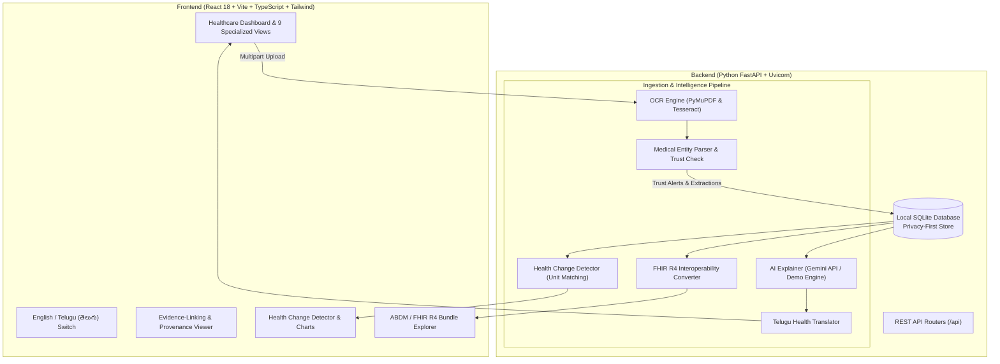

# MediMitra AI — AI-Powered Personal Health Copilot

> **Tagline:** *"Your Health Records. Clearly Understood."*  
> **Hackathon:** HacXLerate 2026 | Round 1  
> **Team:** TEKSQUADS  
> **Status:** Full-Stack Complete & Deployment-Ready

---

## 1. Problem Statement

Patients frequently face fragmented healthcare information across paper prescriptions, clinical laboratory reports, diagnostic imaging, and discharge summaries. Medical terminology is complex and intimidating, previous test values are difficult to track over time, and patients often do not know what questions to ask their clinicians during consultations.

**MediMitra AI** bridges this gap by converting scattered medical documents into organized, understandable, and verifiable health intelligence with strict clinical safety, bilingual explanations (English & Telugu), multi-visit trend detection, and ABDM/FHIR R4 interoperability readiness.

---

## 2. Implemented Capabilities & Differentiating Features

### Core Capabilities
* **Medical Record Intelligence & OCR**: Extracts selectable PDF text via PyMuPDF (`fitz`) and processes scanned images with Tesseract OCR with resilient rule-based fallback. Extracts test names, observed values, standardized units, laboratory reference intervals, medicines, dosages, and diagnoses.
* **AI Health Explainer in Simple Language**: Generates patient-friendly explanations in plain English and natural Telugu (తెలుగు). Strictly interprets abnormal values using only supplied laboratory reference ranges.
* **Unified Health Profile & Timeline**: Chronological interactive repository of health records with search, category filtering, and safe deletion.

### Differentiating Features
* **Feature 1: Health Change Detector**: Compares two reports from the same patient. Validates unit compatibility before comparison. Computes absolute and percentage deltas, plots trend charts, and evaluates whether values moved closer to or further from normal reference limits without claiming clinical recovery. Flags method/unit mismatches as unsafe.
* **Feature 2: Evidence-Linked AI Answers**: Every summary claim links back to the exact source document line and OCR confidence score. Users can click any finding to inspect its provenance.
* **Feature 3: Smart Report Trust Check**: Automatically detects missing units, unreadable scans, missing reference ranges, and incomplete medicine instructions. Preserves the original extracted value when user corrections are submitted.
* **Feature 4: Telugu Health Translator**: High-fidelity Telugu (తెలుగు) medical explanations that strictly preserve medicine names, numerical values, units, and dates unchanged. Supports a simple-language mode.
* **Feature 5: Personal Health Memory**: Chronological timeline with multi-criteria filtering for Laboratory Reports, Prescriptions, Diagnostics, and Discharge Summaries.
* **Feature 6: Doctor Visit Prep Assistant**: Interactive, user-editable checklist of clinician discussion questions derived from abnormal findings, incomplete prescriptions, and trend shifts.
* **Feature 7: Prescription-to-Reminder Planner**: Converts readable instructions into a reviewable daily schedule. Requires user verification before activating reminder alerts. Flags incomplete instructions.
* **Feature 8: Privacy-First Health Vault**: Ephemeral in-memory document processing, local SQLite storage, single-click permanent data purge, and zero tracking.
* **ABDM/ABHA-Ready Architecture Bonus**: Standardized data model inspired by FHIR R4 resources (`Patient`, `DiagnosticReport`, `Observation`, `MedicationRequest`). Includes an interactive FHIR JSON Bundle exporter and synthetic ABHA demo identifier (`91-4582-9012-3456 (Synthetic Demo)`).

---

## 3. Architecture Diagram



---

## 4. Database Schema Documentation

Built using SQLAlchemy ORM with SQLite (foreign key pragmas enabled):

| Table | Purpose | Key Attributes |
|---|---|---|
| `patients` | Patient demographic identity | `id`, `synthetic_abha_id`, `full_name`, `age`, `gender`, `created_at` |
| `documents` | Uploaded document metadata | `id`, `patient_id`, `file_name`, `file_type`, `file_size`, `document_type`, `document_date`, `laboratory_name`, `raw_text`, `trust_score`, `trust_warnings` (JSON), `is_synthetic` |
| `observations` | Extracted laboratory findings (FHIR Observation) | `id`, `document_id`, `test_name`, `standardized_code` (LOINC), `original_value`, `user_corrected_value`, `standardized_value`, `unit`, `reference_range_low`, `reference_range_high`, `reference_range_text`, `interpretation`, `is_verified`, `evidence_excerpt`, `confidence_score` |
| `medications` | Extracted prescriptions (FHIR MedicationRequest) | `id`, `document_id`, `medicine_name`, `dosage`, `frequency`, `timing_instructions`, `duration`, `is_incomplete`, `trust_warning`, `is_verified`, `schedule_time`, `is_reminder_active`, `evidence_excerpt` |
| `summaries` | AI patient explanations | `id`, `document_id`, `english_summary`, `telugu_summary`, `key_findings` (JSON), `questions_for_doctor` (JSON), `uncertainty_notes`, `is_demo_generated` |
| `comparisons` | Multi-visit change records | `id`, `patient_id`, `report_a_id`, `report_b_id`, `comparison_data` (JSON), `safe_comparison` (boolean), `warning_notes` |
| `doctor_questions` | Clinician discussion checklist | `id`, `patient_id`, `source_document_id`, `question_text`, `context_note`, `category`, `is_checked` |

---

## 5. API Endpoint Documentation

All endpoints are prefixed with `/api` and return standardized JSON:

| Method | Endpoint | Description |
|---|---|---|
| `GET` | `/api/health` | Health status check |
| `GET` | `/api/status` | Runtime mode (Demo vs Live), privacy flags, capabilities |
| `GET` | `/api/documents` | List all patient medical records chronologically |
| `GET` | `/api/documents/{id}` | Detailed document report with observations, meds & summary |
| `POST` | `/api/documents/upload` | Upload PDF/image, trigger OCR, parser, AI summary & questions |
| `PUT` | `/api/documents/{id}/observations/{obs_id}` | User field correction (preserves original extracted value) |
| `DELETE` | `/api/documents/{id}` | Permanently delete record and all associated observations |
| `POST` | `/api/documents/reset-demo` | Restore clean synthetic demo records |
| `POST` | `/api/comparison` | Health Change Detector (compares two compatible reports) |
| `GET` | `/api/doctor-prep` | Retrieve doctor visit discussion checklist |
| `POST` | `/api/doctor-prep` | Add user-authored custom question to checklist |
| `PATCH` | `/api/doctor-prep/{id}/toggle` | Toggle question addressed status |
| `DELETE` | `/api/doctor-prep/{id}` | Remove question from checklist |
| `GET` | `/api/medications` | List prescriptions, trust check flags & daily schedule |
| `PATCH` | `/api/medications/{id}` | Update reminder time, active flag & verification status |
| `GET` | `/api/fhir/patient` | Get patient FHIR resource with synthetic ABHA ID |
| `GET` | `/api/fhir/bundle/{document_id}` | Generate FHIR R4 Bundle (Patient, DiagnosticReport, Observations, Meds) |

---

## 6. Windows Installation and Run Instructions

### Prerequisites
* **Python 3.10+**
* **Node.js 18+ & npm**
* (Optional) **Tesseract OCR**: If not installed, MediMitra AI automatically activates its pure-python OCR fallback.
* (Optional) **Google Gemini API Key**: If not configured, MediMitra AI seamlessly runs in high-fidelity **DEMO MODE**.

### Step 1: Clone or Navigate to the Project Directory
```powershell
cd C:\Users\devir\.gemini\antigravity\scratch\MediMitra-ai
```

### Step 2: Configure Environment
Copy `.env.example` to `.env`:
```powershell
Copy-Item .env.example .env
```
*(Optional: Add your `GEMINI_API_KEY` inside `.env`. If left blank, the app runs in full Demo Mode with zero setup!)*

### Step 3: Run the Complete Application (Option A - 1-Click Launcher)
Double-click `start.bat` or run:
```powershell
.\start.ps1
```

### Step 3 (Option B - Manual Terminal Launch):
**Terminal 1 (Backend):**
```powershell
pip install -r requirements.txt
python -m uvicorn backend.app.main:app --host 127.0.0.1 --port 8000 --reload
```

**Terminal 2 (Frontend):**
```powershell
cd frontend
npm install
npm run dev
```

### Step 4: Open in Your Browser
* **Web Application:** `http://localhost:5173`
* **Swagger API Documentation:** `http://127.0.0.1:8000/docs`

---

## 7. Automated Test Suite

Run the comprehensive test suite to verify upload, extraction, summaries, change detection, field corrections, and FHIR export:

```powershell
python backend/tests/run_tests.py
# Or via pytest directly:
pytest -v backend/tests/test_api.py
```

### Verified Test Cases:
1. `test_health_check`: Verifies API health and version.
2. `test_system_status`: Verifies Demo Mode / Live Mode state.
3. `test_list_documents`: Validates chronological record retrieval and synthetic tagging.
4. `test_get_document_detail`: Validates structured observation and summary data.
5. `test_observation_correction_preserves_original`: Tests Smart Trust Check field editing—confirms user correction is recorded separately and original extracted value remains untouched.
6. `test_health_change_detector`: Validates multi-report comparison, unit matching, delta calculations, and reference range shift status ("CLOSER_TO_NORMAL").
7. `test_doctor_visit_prep_checklist`: Tests question creation, toggling, and retrieval.
8. `test_medication_planner`: Tests schedule generation and reminder verification rules.
9. `test_fhir_bundle_generation`: Tests FHIR R4 Bundle validation (Patient, DiagnosticReport, Observation).
10. `test_file_upload_and_extraction`: Tests end-to-end multipart upload and entity parsing.
11. `test_document_deletion`: Validates permanent privacy purge of records.

---

## 8. Hackathon Demo Script for Judges

* **00:00 - 00:30 (Problem & Vision):**  
  Introduce MediMitra AI: "Patients receive confusing, scattered medical reports and don't know what values mean or what to ask their doctors. MediMitra AI transforms these documents into verified, plain-language health intelligence."
* **00:30 - 01:15 (Instant OCR & Field Review):**  
  Click "Upload & Review". Use the 1-click **"Sample Glycemic & Lipid Panel"** button. Point out the extracted values, units, reference intervals, and the **Smart Trust Check** which preserves original OCR values while letting patients submit corrections.
* **01:15 - 02:00 (AI Explainer & Telugu Health Translator):**  
  Navigate to "AI Explainer". Toggle between English and **Telugu (తెలుగు)**. Highlight how Telugu explanations sound natural and respectful while medicine names, numerical values, and units remain clinically intact. Click on **"Fasting Blood Glucose"** to open the **Evidence Viewer Modal**, proving that every claim is linked to the exact source text.
* **02:00 - 02:45 (Health Change Detector):**  
  Open "Change Detector". Select the October 2025 baseline and January 2026 follow-up reports. Show how Fasting Glucose dropped from 142 to 118 mg/dL and HbA1c from 7.4% to 6.8% (moving "CLOSER TO NORMAL"), while Cholesterol normalized. Point out that the system strictly flags numerical shifts without making unsubstantiated claims of clinical cure.
* **02:45 - 03:15 (Doctor Visit Prep & Med Planner):**  
  Show the generated clinician discussion questions. Add a custom patient question and check off an addressed item. Open the Medication Planner and demonstrate how incomplete instructions (Multivitamin) are flagged for verification.
* **03:15 - 03:45 (ABDM Bonus & Privacy Vault):**  
  Open "Privacy & FHIR". Showcase the live FHIR R4 standardized JSON bundle and explain the synthetic ABHA ID architecture designed for future ABDM ecosystem interoperability.

---

## 9. 5-Slide Presentation Outline

* **Slide 1: Title & Vision**  
  * *Title:* MediMitra AI — Your Health Records. Clearly Understood.  
  * *Subheading:* AI-Powered Personal Health Copilot  
  * *Team:* TEKSQUADS | HacXLerate 2026  
  * *Core Value:* Transforming fragmented lab reports into accessible, verifiable health insights.
* **Slide 2: The Core Problem & Clinical Dangers**  
  * 80%+ of patients struggle to interpret laboratory reference ranges.  
  * Previous test comparisons are lost across physical folders.  
  * Generic chatbots hallucinate diagnoses or dangerously recommend dosage changes.
* **Slide 3: Technical Innovations & Differentiating Features**  
  * *Multi-Modal Medical OCR & Provenance:* Selectable PDF extraction + Tesseract OCR.  
  * *Evidence-Linked Answers:* Zero ungrounded claims; every finding links to source text.  
  * *Health Change Detector:* Validates units and methodology before tracking trend shifts.  
  * *Telugu Health Translator:* Clinically precise bilingual translation preserving medical integrity.
* **Slide 4: Privacy-First Architecture & ABDM Readiness**  
  * Ephemeral in-memory file processing (no permanent file storage).  
  * Local SQLite store with single-click permanent data purging.  
  * FHIR R4 standardized data model (Patient, DiagnosticReport, Observation, MedicationRequest).
* **Slide 5: Clinical Safety Principles & Roadmap**  
  * Informational-only guardrails: No automated diagnosis, no dosage alterations.  
  * Verification required for ambiguous prescriptions and low-confidence OCR.  
  * Next steps: ABHA sandbox integration, multi-language expansion (Hindi, Tamil, Kannada), offline edge-AI deployment.

---

## 10. Medical Safety & Privacy Disclaimer

MediMitra AI is an educational, personal health copilot designed to empower patients with clear, structured information. **It is not a medical diagnostic device.** It interprets laboratory values strictly against the reference intervals supplied on your reports and does not independently diagnose diseases, alter medication dosages, or replace the clinical judgment of a qualified medical practitioner.
# AI--POWERED-PERSONAL-HEALTH-COPILOT

